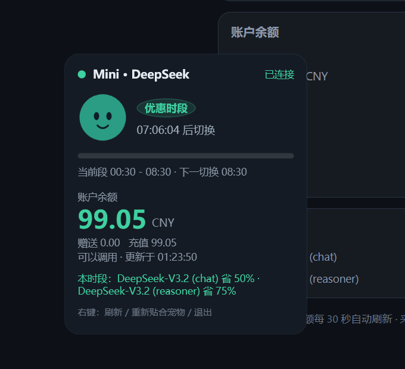
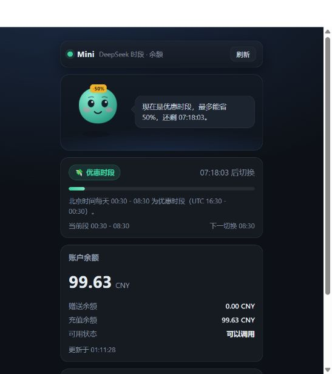

# Mini · 虚拟宠物 — DeepSeek 时段与余额面板

把 DeepSeek 的「当前收费时段」和「账户余额」挂到桌面宠物旁边的一个小面板。

## 两种形态

| 形态 | 启动方式 | 说明 |
| --- | --- | --- |
| 桌面小窗（推荐） | `启动-宠物面板.cmd` | 无边框、置顶，自动贴在 Codex 桌面宠物左侧 |
| 网页版 | `启动.cmd` | 浏览器打开 http://127.0.0.1:8787/ |

## 显示什么

- **当前收费时段**：优惠时段 / 标准时段，距离切换的倒计时和进度条。
- **账户余额**：总额、赠送余额、充值余额、可用状态。
- **本时段折扣**：DeepSeek-V3.2 (chat) 与 (reasoner) 在优惠时段的折扣。
- **宠物状态**：优惠时段戴 `-50%` 牌子；余额低于 10 元或查询失败时换成担心的表情和配色。

## 桌面小窗

双击 `启动-宠物面板.cmd`。内部用 Windows 自带的 PowerShell + WPF，不需要安装任何东西。

- 位置：读取 `~/.codex/.codex-global-state.json` 里的 `electron-avatar-overlay-bounds`（Codex 自己记录的桌面宠物坐标），
  面板右边缘贴在宠物左侧、底部与屏幕下沿留 12 DIP，宠物被拖动后每秒自动跟随。
- 缩放：Windows 显示缩放（100% / 150% 等）会换算，避免面板被顶到屏幕外。
- 右键菜单：立即刷新余额 / 重新贴合宠物 / 退出。
- 出错时错误写进同目录的 `hud.log`。

## 网页版

双击 `启动.cmd`，会启动 `server.js` 并打开 http://127.0.0.1:8787/ 。想换端口就设环境变量 `MINI_PET_PORT`。

## 数据来源

- **时段**：本地按 UTC 16:30 - 00:30（北京时间 00:30 - 08:30）判断，配置在 `pricing.json`，改完两个形态都会跟着变。
- **余额**：`GET https://api.deepseek.com/user/balance`。桌面小窗直接请求；网页版由 `server.js` 代理，因为浏览器直连会被 CORS 拦住。
- **API Key**：从 `~/.codex/config.toml` 的 `[model_providers.deepseek]` 里读 `experimental_bearer_token`，也可以用环境变量
  `DEEPSEEK_API_KEY` 覆盖。Key 只在本地使用，界面只显示掩码。

## 文件

| 文件 | 作用 |
| --- | --- |
| `pet-hud.ps1` | 桌面小窗本体（WPF），含宠物跟随、时段倒计时与余额刷新 |
| `启动-宠物面板.cmd` | 启动桌面小窗 |
| `index.html` / `styles.css` / `app.js` | 网页版界面：宠物、时段、余额 |
| `server.js` | 网页版静态服务 + 余额代理 |
| `启动.cmd` | 启动网页版 |
| `pricing.json` | 优惠时段与各模型折扣 |

## 说明

- 两个形态都只支持 Windows（PowerShell 5.1 + WPF / Node）。
- `pricing.json` 里的折扣比例（chat 50%、reasoner 75%）按 DeepSeek 公开定价填写，官方调整后直接改这个文件即可。
- 桌面小窗的停靠依赖 Codex 桌面端记录宠物位置的配置文件；没有 Codex 时会退回到屏幕右下角。
